# ADAM 2026 赛季 - 哨兵云台代码库

> **构型说明**：本仓库适用于 ADAM 战队 2026 赛季哨兵机器人，采用 **舵轮底盘 + 双 Yaw 轴（大/小 Yaw）云台** 的特殊物理架构。

---

## 1. 云台硬件设备规范 

本赛季云台集成了高性能达妙和大疆电机与海康威视工业相机，构建了全方位的感知与执行系统。

### 核心动力与执行单元
| 节点 | 设备型号 | 
| :--- | :--- | 
| **大 Yaw 轴** | 达妙 DM4310 | 
| **小 Yaw 轴** | 大疆 GM6020 | 
| **Pitch 轴** | 达妙 DM4310 | 
| **摩擦轮** | 大疆 M3508 | 

### 计算与感知系统
* **计算平台**：ASUS 华硕 Ultra-5
* **空间定位**：Livox Mid-360 激光雷达
* **视觉感知**：
    * **主训练相机**：海康威视 CS-016 
    * **全向感知阵列**：海康威视 CS-016 $\times$ 3 

---

## 2. 控制链介绍 

# 🎯 自瞄与开火控制链总体架构图

本项目控制链路分为六个核心层级：
1. **输入校验**：USB 数据异步接收与 CRC 校验。
2. **档位决策**：遥控器本地逻辑与安全态锁定。
3. **状态仲裁**：视觉追踪、扫描与前馈锁存。
4. **云台执行**：PID 闭环计算与前馈补偿。
5. **开火仲裁**：摩擦轮转速与视觉许可双重校验。
6. **物理执行**：CAN 总线指令分发。

```mermaid
%%{init: {
  "theme": "base",
  "flowchart": {
    "curve": "linear",
    "nodeSpacing": 16,
    "rankSpacing": 20
  },
  "themeVariables": {
    "background": "#F6F8FA",
    "fontFamily": "Inter, Segoe UI, Microsoft YaHei, Arial",
    "fontSize": "13px",
    "lineColor": "#57606A",
    "textColor": "#24292F",
    "clusterBkg": "#FFFFFF",
    "clusterBorder": "#D0D7DE",
    "edgeLabelBackground": "#FFFFFF"
  }
}}%%
flowchart LR

    classDef io fill:#FFFFFF,stroke:#1A7F37,stroke-width:2px,color:#24292F;
    classDef remote fill:#FFFFFF,stroke:#BF8700,stroke-width:2px,color:#24292F;
    classDef auto fill:#FFFFFF,stroke:#0969DA,stroke-width:2px,color:#24292F;
    classDef gimbal fill:#FFFFFF,stroke:#8250DF,stroke-width:2px,color:#24292F;
    classDef shoot fill:#FFFFFF,stroke:#CF222E,stroke-width:2px,color:#24292F;
    classDef chassis fill:#FFFFFF,stroke:#1B7C83,stroke-width:2px,color:#24292F;
    classDef decision fill:#FFF8C5,stroke:#9A6700,stroke-width:1.8px,color:#24292F;
    classDef state fill:#F6F8FA,stroke:#8C959F,stroke-width:1.6px,stroke-dasharray: 4 3,color:#24292F;
    classDef debug fill:#F6F8FA,stroke:#8C959F,stroke-width:1.4px,color:#24292F;

    subgraph SYS["Auto-Aim Fire-Control Chain"]
        direction LR

        M0["MiniPC<br/>mode / yaw / pitch / yaw_vel / pitch_vel / yaw_acc / pitch_acc"]:::io

        subgraph USB["USB Input"]
            direction TB
            U1["Vircom_Rev()<br/>receive packet"]:::io
            U2{"header ok ?"}:::decision
            U3{"length ok ?"}:::decision
            U4{"CRC16 ok ?"}:::decision
            U5["write shadow copy<br/>fromMINIPC_shadow<br/>minipc_last_rx_tick<br/>minipc_rx_seq++"]:::io
            U6["drop packet"]:::state

            U1 --> U2
            U2 -- yes --> U3
            U2 -- no --> U6
            U3 -- yes --> U4
            U3 -- no --> U6
            U4 -- yes --> U5
            U4 -- no --> U6
        end

        subgraph RC["Remote Control"]
            direction TB
            R1["RCdata_Updater()<br/>update RC_data"]:::remote
            R2["RC_Controller()"]:::remote
            R3{"LOCK / offline ?"}:::decision
            R4["safe state<br/>LOCK + manual close"]:::remote
            R5["run state"]:::remote
            R6["select chassis mode"]:::remote
            R7["manual pitch / yaw setpoint<br/>if AutoAim is not controlling"]:::remote
            R8{"enter auto-aim ?"}:::decision
            R9["Auto.mode = CAR"]:::remote
            R10["Auto.mode = NONE"]:::remote
            R11["select shoot_mode<br/>CLOSE / READY"]:::remote
            R12{"manual mode ?"}:::decision
            R13["set manual_tigger_mode"]:::remote
            R14["manual_tigger_mode = TRIGGER_CLOSE"]:::remote

            R1 --> R2 --> R3
            R3 -- yes --> R4
            R3 -- no --> R5 --> R6 --> R7 --> R8
            R8 -- yes --> R9 --> R11 --> R12
            R8 -- no --> R10 --> R11 --> R12
            R12 -- yes --> R13
            R12 -- no --> R14
        end

        subgraph AA["AutoAim Core"]
            direction TB
            A0["AutoAim_Update() @ 1 kHz"]:::auto
            A1["shadow -> working copy"]:::auto
            A2["MINIPC_to_STM32()"]:::auto
            A3["compute rx_fresh / is_new_pkt / mode_raw"]:::auto
            A4["AA.control_req =<br/>rx_fresh && mode_raw != 0"]:::auto
            A5{"new packet && sane ?"}:::decision
            A6["latch target and feedforward"]:::auto
            A7["clear feedforward when control is lost"]:::auto
            A8["EdgeAction_Update()"]:::auto
            A9{"rising edge ?"}:::decision
            A10["freeze one tick + reset PID<br/>sync setpoint to current position"]:::state
            A11{"falling edge ?"}:::decision
            A12["reset PID + clear FF"]:::state
            A13["Planner_Update()"]:::auto
            A14{"Auto.mode == NONE ?"}:::decision
            A15["AIM_OFF"]:::state
            A16{"reacquire_freeze ?"}:::decision
            A17["AIM_REACQUIRE"]:::state
            A18{"AA.control_req ?"}:::decision
            A19["AIM_TRACK<br/>Auto_Control()"]:::state
            A20["AIM_SCAN<br/>Scan_Reset / Scan_Internal"]:::state
            A21["FireGate_Update()"]:::auto
            A22["mcu_fire_permit =<br/>Auto.mode != NONE<br/>&& rx_fresh<br/>&& mode_raw == 2<br/>&& shoot_status == OK"]:::auto
            A23["DebugFill_Update()"]:::debug
            A24["save control_req_last"]:::auto

            A0 --> A1 --> A2 --> A3 --> A4 --> A5
            A5 -- yes --> A6 --> A7 --> A8
            A5 -- no --> A7 --> A8
            A8 --> A9
            A9 -- yes --> A10 --> A11
            A9 -- no --> A11
            A11 -- yes --> A12 --> A13
            A11 -- no --> A13
            A13 --> A14
            A14 -- yes --> A15 --> A21
            A14 -- no --> A16
            A16 -- yes --> A17 --> A21
            A16 -- no --> A18
            A18 -- yes --> A19 --> A21
            A18 -- no --> A20 --> A21
            A21 --> A22 --> A23 --> A24
        end

        subgraph GB["Gimbal"]
            direction TB
            G0["Gimbal_Tasks() @ 1 kHz"]:::gimbal
            G1["Gimbal_Updater()"]:::gimbal
            G2{"AutoAim controls gimbal ?"}:::decision
            G3["apply auto / scan setpoint"]:::gimbal
            G4["apply manual setpoint"]:::gimbal
            G5["Gimbal_Calculater()"]:::gimbal
            G6{"tracking ?"}:::decision
            G7["normal yaw loops"]:::gimbal
            G8["auto yaw loops + yaw_ff"]:::gimbal
            G9["Gimbal_Controller()<br/>drive motors or disable in LOCK"]:::gimbal

            G0 --> G1 --> G2
            G2 -- yes --> G3 --> G5
            G2 -- no --> G4 --> G5
            G5 --> G6
            G6 -- no --> G7 --> G9
            G6 -- yes --> G8 --> G9
        end

        subgraph SH["Fire Selection"]
            direction TB
            S0["Shoot_Tasks() @ 1 kHz"]:::shoot
            S1["Shoot_Updater()<br/>update shoot_status"]:::shoot
            S2{"READY and wheels near target ?"}:::decision
            S3["shoot_status = OK"]:::shoot
            S4["shoot_status = NOK"]:::shoot
            S5["Shoot_SelectTriggerMode()<br/>only writer of tigger_mode"]:::shoot
            S6{"LOCK or shoot_mode == CLOSE ?"}:::decision
            S7["TRIGGER_CLOSE"]:::shoot
            S8{"auto-aim mode ?"}:::decision
            S9["auto path<br/>mcu_fire_permit ? ONLY_AIM_HIGH : TRIGGER_CLOSE"]:::shoot
            S10["manual path<br/>shoot_status == OK ? manual_tigger_mode : TRIGGER_CLOSE"]:::shoot

            S0 --> S1 --> S2
            S2 -- yes --> S3 --> S5
            S2 -- no --> S4 --> S5
            S5 --> S6
            S6 -- yes --> S7
            S6 -- no --> S8
            S8 -- yes --> S9
            S8 -- no --> S10
        end

        subgraph CH["Chassis CAN Output"]
            direction TB
            C0["Chassis_Tasks() @ 1 kHz"]:::chassis
            C1["Pack_R_Yaw()<br/>big-yaw follows small-yaw when AutoAim is active"]:::chassis
            C2["Pack_TRIGGER_MODE()<br/>pack tigger_mode"]:::chassis
            C3["CAN_ID_SHOOT_TRIGGER_MODE<br/>send at 200 Hz"]:::chassis
            C4["chassis board executes feeding"]:::chassis

            C0 --> C1 --> C2 --> C3 --> C4
        end
    end

    M0 --> U1
    U5 -->|vision source| A1

    R9 -->|auto mode| A13
    R10 -->|manual mode| A13
    R11 -->|shoot_mode| S1
    R13 -->|manual_tigger_mode| S5
    R14 -->|manual_tigger_mode| S5

    A24 -->|gimbal control| G0
    S1 -->|shoot_status| A21
    A22 -->|mcu_fire_permit| S5
    A24 -->|AA.state| C1
    S5 -->|tigger_mode| C2

    style SYS fill:#F6F8FA,stroke:#D0D7DE,stroke-width:1.6px,color:#24292F
    style USB fill:#FFFFFF,stroke:#D0D7DE,stroke-width:1.2px,color:#24292F
    style RC fill:#FFFFFF,stroke:#D0D7DE,stroke-width:1.2px,color:#24292F
    style AA fill:#FFFFFF,stroke:#D0D7DE,stroke-width:1.2px,color:#24292F
    style GB fill:#FFFFFF,stroke:#D0D7DE,stroke-width:1.2px,color:#24292F
    style SH fill:#FFFFFF,stroke:#D0D7DE,stroke-width:1.2px,color:#24292F
    style CH fill:#FFFFFF,stroke:#D0D7DE,stroke-width:1.2px,color:#24292F

    linkStyle default stroke:#57606A,stroke-width:1.6px,fill:none;

```
